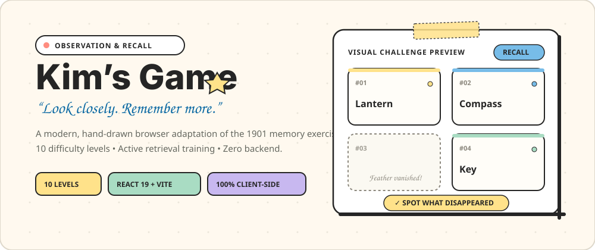

<p align="center">
  
</p>

<p align="center">
  <strong>A classic memory and observation training challenge adapted for the modern web.</strong><br>
  <em>“Look closely. Remember more.”</em>
</p>

<p align="center">
  
  
  
  
  
  
</p>

---

## 📖 Overview

**Kim’s Game** is an engaging, lightweight browser-based brain-training game that helps players exercise visual attention, working memory, and active recall. Inspired by Rudyard Kipling’s 1901 espionage novel *Kim* and Sir Robert Baden-Powell’s 1921 *Scouting Games*, this modern web edition transforms a 120-year-old training method into a tactile, notebook-styled indie web game.

Players study a collection of flashcards on a virtual paper desk, notice which cards vanish into thin air, and identify the missing items under strict countdown timers.

---

## 🎯 How to Play (The Kim’s Game Method)

```
  ┌──────────────┐       ┌──────────────┐       ┌──────────────┐       ┌──────────────┐
  │  1. OBSERVE  │  ──>  │  2. VANISH   │  ──>  │  3. RECALL   │  ──>  │   4. SCORE   │
  │ Study N cards│       │  P items are │       │ Select cards │       │ +10 pts each │
  │ for K seconds│       │ removed      │       │ before timer │       │ & accuracy % │
  └──────────────┘       └──────────────┘       └──────────────┘       └──────────────┘
```

1. **Observe & Memorise:** Display $N$ tangible word flashcards for $K$ seconds. Group items mentally and anchor their spatial placements.
2. **Recall & Spot Changes:** $P$ words disappear from the board. The desk preserves slot positions so you can compare remaining cards against mental memory traces.
3. **Select Missing Items:** Pick the missing words from an options pool containing the missing items and 4 plausible distractors before the answer clock runs out.
4. **Evaluate & Continue:** Receive immediate feedback showing correct items, missed items, and points earned (+10 points per correct answer). Advance through configured rounds to your final report card.

---

## 🎚️ 10 Difficulty Levels

The game features 10 difficulty configurations calibrated to human working memory thresholds:

| Level | Tier | Title | Flashcards ($N$) | Missing ($P$) | Time per Phase ($K$) |
| :---: | :--- | :--- | :---: | :---: | :---: |
| **1** | Beginner | Baby’s First Memory Test | 8 | 2 | 8 sec |
| **2** | Beginner | Completely Average | 10 | 3 | 7 sec |
| **3** | Easy | Getting Mildly Confused | 13 | 4 | 6 sec |
| **4** | Easy | Brain Cells Firing | 16 | 5 | 6 sec |
| **5** | Intermediate | The Illusion of Competence | 20 | 7 | 5 sec |
| **6** | Intermediate | Oh Look, You Made It | 24 | 9 | 5 sec |
| **7** | Hard | Approaching Memory Loss | 28 | 11 | 4 sec |
| **8** | Hard | Dazed and Confused | 33 | 13 | 4 sec |
| **9** | Expert | Complete Mental Collapse | 38 | 16 | 3 sec |
| **10** | Expert | Certified Amnesiac | 45 | 20 | 3 sec |

---

## 🔬 Cognitive Science & Evidence-Based Distinctions

Kim’s Game is grounded in cognitive psychology and memory research:

- **Working Memory Capacity Limits:** George Miller’s (1956) classic formulation ($7 \pm 2$) and Nelson Cowan’s (2001) working memory model emphasize that humans hold 4 to 7 chunks in immediate focus. Levels 1–3 operate comfortably within standard working memory limits, while Levels 5–10 deliberately demand chunking, semantic grouping, and visual scanning strategies.
- **Active Recall & The Testing Effect:** As demonstrated by Roediger & Karpicke (2006), effortful retrieval from memory produces substantially stronger and more durable retention pathways than passive re-study.
- **Selective Attention & Visual Search:** Rapid inspection under countdown pressure trains attentional inhibition—filtering noise while tracking spatial and conceptual relationships.

### 📌 Scientific Honesty: What Science Demonstrates vs. What It Does Not

To uphold research integrity, Kim’s Game makes clear distinctions between supported cognitive effects and unsupported marketing hype:

| Supported by Cognitive Science | ⚠️ Not Scientifically Demonstrated (No False Claims) |
| :--- | :--- |
| **Task-specific recall efficiency:** Regular practice improves observation speed, mnemonic chunking, and task-specific recall performance. | **No proven general IQ increase:** Meta-analyses (e.g. Simons et al., 2016) show brain games do not reliably elevate general intelligence ($g$-factor). |
| **Selective attentional discipline:** Timed recall promotes systematic visual scanning and reduces on-task distractibility. | **No clinical cure or dementia prevention:** Playing memory games cannot be claimed to prevent Alzheimer’s, dementia, or clinical neurodegeneration without clinical trials. |
| **Retrieval pathway strengthening:** Effortful recall solidifies memory traces better than passive exposure. | **No photographic memory creation:** Gains represent improved chunking techniques, not fundamental changes to biological storage ceilings. |

---

## 📜 Historical Origins

- **1901 — Rudyard Kipling’s *Kim*:** In Chapter IX, Kim undergoes observation training in Simla with British intelligence agent Mr. Lurgan. Lurgan casts 15 jewels on a copper tray, covers them after a brief observation window, and commands Kim to tally every jewel and its imperfections. Lurgan’s motto: *“Do it many times over till it is done perfectly — for it is worth doing.”*
- **1921 — Sir Robert Baden-Powell’s *Scouting Games*:** Adapted into Chapter IV of Baden-Powell’s scout manual to teach situational alertness, memory, and visual tracking in outdoor observation.
- **Modern Day — Elite Military Reconnaissance:** Taught at the US Marine Corps (USMC) Scout Sniper Instructor School (Quantico, Camp Lejeune, Camp Pendleton) and British Royal Marines Commando sniper training under the backronym **K.I.M.** (*“Keep In Memory”*).

---

## ✨ Key Features

- **Reliable Game State Persistence:** Refreshing the browser never destroys an active session or resets progress. The game safely persists the current phase (`memorise`, `answer`, `round-review`, `results`), round index, selected answers, score history, and remaining timer using absolute timestamp deadlines.
- **Zero Timer Duplication:** Deadline-based timer hook (`useTimer`) prevents interval accumulation, drift, or tab-throttling issues.
- **Interactive In-Browser Walkthrough:** A 5-second interactive demonstration on the welcome page lets first-time visitors experience cards appearing, vanishing, and being recalled before configuring a game.
- **Handcrafted Notebook & Doodle Aesthetic:** Warm paper cream (`#FFF9EF`), ink black (`#252525`), spiral-notebook margins, tactile paper drop shadows, and pastel accents (`#FFE28A`, `#77BCE8`, `#A9DCC3`, `#FF8D80`, `#C8B8F0`).
- **Curated 250+ Concrete Noun Word Bank:** Expansive word bank (`public/words.json`) prevents repetition and guarantees distractor availability even during extended 10-round Expert sessions.
- **Graded Observer Report Card:** Final results screen provides total score, overall accuracy %, performance assessment, personal best recognition, and round-by-round score breakdown.
- **Score Sharing:** Seamless Web Share API integration on supported mobile devices with automatic clipboard fallback and toast feedback.

---

## 🛠️ Technology Stack

| Layer | Technology | Purpose |
| :--- | :--- | :--- |
| **UI Library** | React 19 (`^19.3.1`) | Functional components, state hooks, and declarative rendering |
| **Build Tool** | Vite 8 (`^8.3.4`) | Fast HMR development server and optimized production bundling |
| **Styling** | Vanilla CSS3 | Custom design system, tactile paper drop shadows, and responsive grid |
| **Typography** | Google Fonts | *Space Grotesk* (headings), *Plus Jakarta Sans* (body), *Patrick Hand* (handwritten accents) |
| **Persistence**| Browser `localStorage` | Active game session, player name, instructions status, and best score |
| **Linter** | Oxlint | High-performance linter checking React compiler rules and code quality |

---

## 📂 Project Architecture

```
kims_Game/
├── public/
│   ├── banner.svg           # High-resolution SVG hero banner for GitHub
│   ├── favicon.svg          # Custom notebook-themed SVG favicon
│   ├── words.json           # Curated bank of 250+ concrete noun flashcards
│   └── icons.svg            # Supporting SVG assets
├── src/
│   ├── components/
│   │   ├── AnswerOptions.jsx# Recall answer selection tiles and submit button
│   │   ├── GameHeader.jsx   # Notebook header, round indicator, best score pill
│   │   ├── ResultsScreen.jsx# Graded notebook report card & share actions
│   │   ├── RoundReview.jsx  # Round-by-round summary and feedback chips
│   │   ├── SetupScreen.jsx  # Welcome page, interactive demo, 10 level tiles, research
│   │   ├── WelcomeModal.jsx # First-visit modal with visual demo walkthrough
│   │   └── WordGrid.jsx     # Responsive flashcard grid with vanished slots
│   ├── data/
│   │   └── levels.js        # Exact PRD-compliant 10 difficulty configurations
│   ├── hooks/
│   │   ├── useTimer.js      # Robust deadline-based countdown timer hook
│   │   └── userTimer.js     # Backwards-compatibility alias
│   ├── utils/
│   │   ├── gameLogic.js     # Round generation, shuffling, fresh word selection
│   │   ├── scoring.js       # Score evaluation, accuracy, missed item breakdown
│   │   └── storage.js       # Safe localStorage read/write with recovery fallbacks
│   ├── App.css              # Hand-drawn notebook theme, paper textures, responsive styles
│   ├── App.jsx              # Main controller, refresh restoration, phase routing
│   ├── index.css            # Base typography, CSS variables, notebook dotted canvas
│   └── main.jsx             # React entry point
├── package.json
└── README.md
```

---

## 🚀 Getting Started

### Prerequisites

- [Node.js](https://nodejs.org/) LTS (v18 or higher recommended; tested up to Node 24)
- npm (comes bundled with Node.js)

### Installation

1. Clone the repository and navigate into the project directory:
   ```bash
   git clone https://github.com/your-username/kims_Game.git
   cd kims_Game
   ```

2. Install dependencies:
   ```bash
   npm install
   ```

3. Launch the development server:
   ```bash
   npm run dev
   ```
   Open your browser at `http://localhost:5173`.

### Production Build

Create an optimized, minified production build:
```bash
npm run build
```

Preview the production build locally:
```bash
npm run preview
```

Run code verification and linting:
```bash
npm run lint
```

---

## 🧪 Verification & Testing

The core game logic has been verified via automated test suites covering:
- Exact compliance of all 10 difficulty levels with PRD parameters ($N$ words, $P$ missing, $K$ seconds).
- Round generation across all levels with valid missing and visible partitions.
- Distractor generation with zero duplicate choices.
- Scoring accuracy and missed-word detection under perfect, partial, and empty answer conditions.
- Browser refresh session persistence and graceful timer recovery.

---

## 📚 References & Citations

1. **Kipling, R. (1901).** *Kim*. London: Macmillan & Co. Ltd. [Wikipedia Entry](https://en.wikipedia.org/wiki/Kim%27s_Game).
2. **Baden-Powell, R. S. S. (1921).** *Scouting Games*. Chapter IV: Observation Games. [Online Reference](https://en.wikipedia.org/wiki/Scouting_Games).
3. **Miller, G. A. (1956).** The magical number seven, plus or minus two: Some limits on our capacity for processing information. *Psychological Review*, 63(2), 81–97.
4. **Cowan, N. (2001).** The magical number 4 in short-term memory: A reconsideration of mental storage capacity. *Behavioral and Brain Sciences*, 24(1), 87–114.
5. **Roediger, H. L., & Karpicke, J. D. (2006).** The power of testing memory: Basic research and implications for educational practice. *Perspectives on Psychological Science*, 1(3), 181–210.
6. **Simons, D. J., et al. (2016).** Do “brain-training” programs work? *Psychological Science in the Public Interest*, 17(3), 103–186.
7. **United States Marine Corps.** *Scout Sniper Training Curriculum & Observation Exercises*. [USMC Scout Sniper Overview](https://en.wikipedia.org/wiki/United_States_Marine_Corps_Scout_Sniper).

---

## 📄 License

This project is open source and available under the [MIT License](LICENSE).
